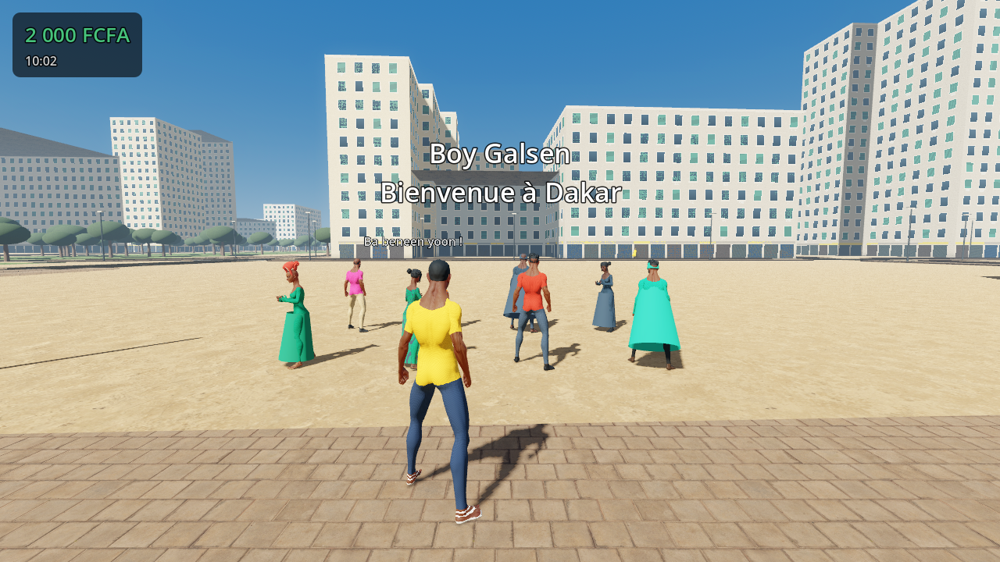

# Boy Galsen

Jeu en monde ouvert à la troisième personne : on incarne un jeune qui vit sa vie dans les rues du Sénégal, en commençant par **Dakar**. On se balade, on parle aux gens du quartier et on rend des services (missions) pour gagner sa vie.

Moteur : **Godot 4.3** (gratuit, open source). Plateformes visées : PC (Windows / Mac), Android, puis consoles.

> État : prototype jouable (v0.2). Les personnages sont de vrais modèles humains animés. Les bâtiments sont encore simplifiés : voir [docs/ASSETS.md](docs/ASSETS.md).



## Lancer le jeu

1. Installe **Godot 4.3** (version « Standard », pas .NET) : https://godotengine.org/download/archive/4.3-stable/
2. Ouvre Godot, clique sur **Importer**, choisis le fichier `project.godot` de ce dossier.
3. Appuie sur **F5** (ou le bouton ▶) pour jouer.

## Commandes

| Action | Clavier / souris | Manette |
| --- | --- | --- |
| Se déplacer | ZQSD (AZERTY) / WASD (QWERTY) ou flèches | Stick gauche |
| Regarder | Souris | Stick droit |
| Courir | Maj | Clic stick gauche / RB |
| Sauter | Espace | A |
| Parler / continuer un dialogue | E ou clic | X |
| Monter dans un véhicule / descendre | E (près d'un véhicule) | X |
| Conduire : accélérer, freiner, tourner | Z / S, Q / D (ou flèches) | Stick gauche |
| Frein à main | Espace | A |
| Libérer la souris | Échap | Start |

## Ce qu'il y a déjà

- **Le vrai centre de Dakar**, construit à partir d'OpenStreetMap : 6 583 bâtiments à leur vraie forme, 1 766 rues, la côte et l'océan, la Place de l'Indépendance, Sandaga, les mosquées avec dôme et minaret, des parcs. On y trouve aussi de vrais commerces, des trottoirs qu'on peut monter, des lampadaires qui éclairent la nuit et 260 véhicules garés : de vrais modèles 3D de cars rapides, taxis sénégalais, clandos, Peugeot 405, mobylettes, plus des Ndiaga Ndiaye.
- (Ancien générateur de secours) un quartier de 6 × 6 pâtés de maisons inspiré de la Médina et du Plateau : immeubles bas aux couleurs chaudes, cours intérieures, toits-terrasses avec citernes et fers à béton, balcons et volets. On y trouve des boutiques avec enseignes (boulangerie, pharmacie, dibiterie, télécentre, tailleur…), le **Marché Teranga**, la **Place de la Teranga**, des taxis jaunes et noirs garés et des lampadaires.
- Un cycle jour / nuit : soleil de Dakar, couchers de soleil orangés, fenêtres et lampadaires allumés la nuit.
- **Des personnages humains réalistes et animés** (modèles et animations CC0 de Quaternius) : peaux noires de différents tons, cheveux, barbe. On voit des t-shirts, des chemises en wax, des grands boubous, des robes longues et des foulards. Les animations couvrent le repos, la marche, la course, le sprint et le saut.
- Des passants qui marchent sur les trottoirs et traversent aux passages piétons.
- 6 personnages du quartier (Adja Fatou, Tonton Moussa, Mame Diarra, Modou le tailleur, Awa, Ibou) et **6 missions** enchaînées, avec dialogues en français et expressions en wolof.
- **Conduite** : on peut prendre n'importe quel véhicule garé, ou voler celui d'un conducteur (il est sorti de force et s'enfuit). Il y a une caméra de poursuite, un compteur de vitesse et des phares la nuit.
- **Circulation automatique** : taxis, cars rapides, clandos, Ndiaga Ndiaye et mobylettes roulent à droite dans les vraies rues. Ils choisissent leur chemin aux carrefours et freinent devant les piétons.
- **Vie de rue** : des passants discutent en petits groupes, avec gestes et bulles en wolof et en français. Ils saluent le joueur qui passe.
- Une interface : argent en FCFA, heure, objectif, distance, boussole vers l'objectif, dialogues.
- Une sauvegarde automatique (argent, missions terminées, heure).

## Organisation du projet

```
project.godot              configuration du projet
scenes/main.tscn           scène principale
scripts/
  main.gd                  assemble le monde, gère le jour et la nuit
  core/game.gd             état global (autoload « Game ») : argent, sauvegarde, commandes
  world/city_generator.gd  génération du quartier
  characters/              joueur, passants, personnages
    real_character.gd      personnage réaliste : habillage, cheveux, animations
    clothing.gdshader      vêtements dessinés sur le corps (t-shirt, pantalon, wax…)
    humanoid.gd            choisit le modèle réaliste (ou un corps simple de secours)
  missions/                gestionnaire de missions
  ui/hud.gd                interface
data/missions.json         personnages et missions (modifiable sans toucher au code)
assets/                    modèles 3D, animations, crédits (assets/CREDITS.md)
docs/                      vision, feuille de route, guide des modèles 3D
tests/validate.gd          vérifie la cohérence des missions et de la ville
```

## Mettre à jour ou agrandir la carte de Dakar

```
python3 tools/osm_download.py SUD OUEST NORD EST dossier_tuiles       # télécharge la zone (API OpenStreetMap)
python3 tools/osm_to_game.py dossier_tuiles data/map/dakar_centre.json SUD OUEST NORD EST
```

Zone actuelle : `14.655 -17.455 14.695 -17.420` (Plateau, Médina, Fann, Colobane, Corniche ouest).
Carte © les contributeurs OpenStreetMap (ODbL).

## Ajouter une mission

Tout se passe dans `data/missions.json` :

- **`npcs`** : les personnages, avec leur nom, leur apparence et l'endroit où ils se trouvent. `near` vaut `start`, `far` ou un lieu de la ville.
- **`missions`** : le donneur (`giver`), les dialogues `intro` et `outro`, la récompense, les missions à finir avant (`requires`) et les étapes.
  - Une étape `goto` envoie à un lieu : `boulangerie`, `pharmacie`, `dibiterie`, `telecentre`, `tailleur`, `garage`, `boutique`, `marche` ou `place`.
  - Une étape `talk` demande de parler à un personnage.

Vérifie ensuite que tout est cohérent :

```
godot --headless --path . --script res://tests/validate.gd
```

Pour tester la conduite, la circulation et le vol de voiture :

```
godot --headless --path . -- --drivetest
```

Pour jouer automatiquement la première mission et vérifier qu'elle se termine bien :

```
godot --headless --path . -- --selftest
```

## Outil de capture

Pour lancer le jeu à une heure donnée et enregistrer une image :

```
godot --path . -- --time=18.5 --capture=res://capture.png
```

## Documentation

- [docs/GAME_DESIGN.md](docs/GAME_DESIGN.md) : la vision du jeu
- [docs/ROADMAP.md](docs/ROADMAP.md) : les prochaines étapes jusqu'à la publication
- [docs/ASSETS.md](docs/ASSETS.md) : les personnages réalistes, les textures et les licences
